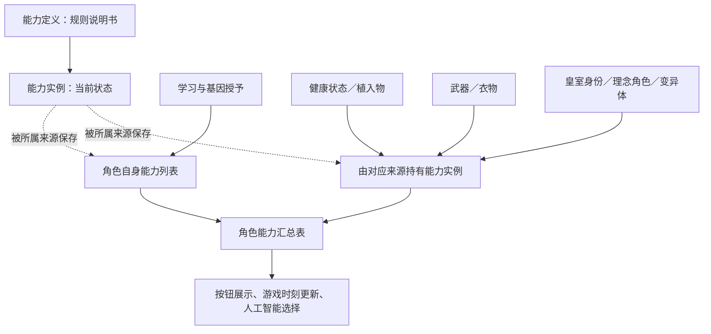
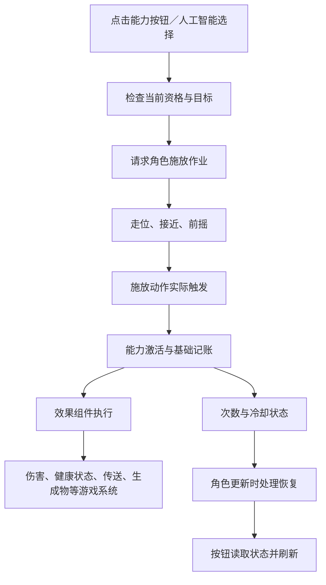

# 原版能力：充能、冷却、公共入口与上下游

研究日期：2026-10-14。用户确认同时查看 1.6、1.7，允许以 1.7 为主。本次为机制调查，没有修改游戏功能、构建或部署。

## 1. 先给结论

玩家口中的“能力”，比代码中的 `RimWorld.Ability`（原版能力类）范围更大。灵能、基因、健康状态、装备、衣物、身份等可以提供 Ability（能力对象）；另一些衣物按钮直接使用 Verb（施放动作）和衣物组件，不经过 Ability（能力对象）。

按“次数怎么恢复”便于理解地归纳为六种基础用法。这个数字是研究中的概念分类，不是原版规定的六个类型，也不是全部组合数。冷却、次数、资源和状态限制可以叠加。

原版有可复用的公共入口，但没有一个同时覆盖所有来源、全部恢复方式和全部资源的统一接口。要区分：同一个能力类上的公共成员、组件之间共享的接口、整个游戏通用的能力协议。这三者不是一回事。

## 2. 六种基础用法

| 概念类型 | 玩家看到的行为 | 原版实现位置与示例 |
|---|---|---|
| 无独立长冷却、无有限次数 | 用后可再施放，但仍可能需要前摇、动作恢复或资源 | Ability（能力）不设置独立冷却与次数；灵能“麻痹”、血原质能力“伤口凝结”体现资源限制 |
| 每次使用后冷却 | 用一次，等待，再用 | Ability 的冷却区间，基因“火焰吐息” |
| 次数用尽后整批恢复 | 有剩余次数时可继续用；最后一次用完才进入恢复等待 | Ability 的 `charges`（初始次数）大于零，`cooldownPerCharge`（逐次恢复）为假；机械“跳跃弹射器” |
| 逐次自动恢复 | 缺次数就开始计时，每完成一轮补一次；有剩余次数仍能施放 | Ability 的 `cooldownPerCharge`（逐次恢复）为真；“唤兽战吼”“虚空之惧” |
| 消耗材料装填 | 等待本身不补次数，需要取得材料并执行装填 | `CompApparelReloadable`（衣物装填组件）或 `CompEquippableAbilityReloadable`（装备能力装填组件）；跳跃背包使用化合燃料，地狱猫步枪喷火使用生物铁 |
| 有限次数、不补充 | 用完即耗尽；配置允许时物品直接销毁 | 衣物次数组件的 `destroyOnEmpty`（耗尽销毁），并且没有材料装填或自动恢复；心灵冲击枪、便携护盾背包 |

示例来自当前本地运行时定义快照，只用于说明原版定义的实现分路。该快照加载了 BDP，数据库没有可核验的游戏版本元数据，本研究不把它当作两个版本的纯净数值对照，不据此宣称所有原版定义的数值完全一致。

### 三种等待的区别

```text
每次冷却：  释放 ── 等待 ── 释放 ── 等待
整批恢复：  3 → 2 → 1 → 耗尽 ── 等待 ── 恢复整批
逐次恢复：  3 → 2 → 1 ── 等待 ── 2 ── 等待 ── 3
材料装填：  3 → 2 → 1 → 0 ── 取得材料并装填 ── 补回次数
```

这些示意表达的是使用资格，不表示每一次内部字段变化，也省略了施放动作时间。逐次恢复只有一个顺序运行的计时器，不是每次消耗分别开一个并行计时器。计时过程中继续消耗剩余次数，一般不会把当前恢复计时重新开始。

衣物和装备装填组件还提供 `replenishAfterCooldown`（用尽后等待补满）配置。这种玩家体验同样属于“整批恢复”，实现却在物品组件里，而不是 Ability 的冷却里。

## 3. 另外三个独立维度

### 共享冷却

`AbilityDef.groupDef`（能力分组）可以让同一角色的一组能力共享冷却。施放一个能力时，会通知当前汇总能力列表里同组的能力启动冷却；部分理念仪式也接收对应通知。它是叠加规则，不是全新的次数补充方式。`groupAbility`（按钮编组）是另一项配置，不等于共享冷却。

### 资源消耗

冷却结束不保证资源够用。资源充足也不保证冷却结束。

- `Psycast`（灵能能力类）继承 Ability，检查和处理灵能等级、灵能专注及神经热量。
- `CompAbilityEffect_HemogenCost`（血原质消耗效果组件）负责血原质的按钮检查、人工智能检查及实际扣除，调用 `GeneUtility.OffsetHemogen`（改变血原质）。
- 燃料、物品、健康状态及特殊业务条件由对应系统处理，不统一归到一个“能量值”。

### 外部限制与特殊时序

`hasExternallyHandledCooldown`（声明外部处理冷却）只参与 Ability 对“是否具有冷却”的判断，不会自动寻找并统一任意外部计时器。实际启动和更新仍需看调用者。

`waitForJobEnd`（等待作业结束）以及特定 Job（角色作业）会影响冷却时序。远程护盾使用此配置；标准能力作业驱动也包含针对 `abilityCasting`（能力施放作业标记）的结束处理。因此不能假定所有能力都在点击按钮时启动冷却。

健康状态等还可能独立限制再次使用，或者产生再次使用的特殊代价。这种限制不能一律解释成 Ability 自己的冷却条。

## 4. Ability 的上游：谁给角色这个能力

把 AbilityDef（能力定义）理解成“技能说明书”，Ability（能力对象）理解成“某个人或某件物品正在使用的那一份技能”。前者配置规则；后者保存次数、冷却等当前状态。



`pawn.abilities.AllAbilitiesForReading`（角色全部 Ability 能力的汇总列表）是重要的原版入口。它合并角色自身列表、健康状态、主武器的能力组件、衣物定义能力、变异体、皇室与理念角色能力，并进行相关过滤和排序。

基因授予能力时，通过 `GainAbility`（获得能力）进入角色自身列表；移除基因时有相应移除逻辑。健康状态、装备和衣物等来源可以持有自己的能力实例，汇总表只是把它们纳入当前可见范围，不必复制成永久学习的能力。

需要记住的两个边界：

- `GetAbility(def, includeTemporary: true)`（按定义查找且包含临时能力）才会查汇总列表；默认查询只查角色自身列表。
- `RemoveAbility`（移除能力）操作角色自身列表，不是通用的“移除任何来源能力”。卸下装备、移除健康状态等，应让真实来源的正常流程处理。

## 5. Ability 的下游：角色怎样把能力用出来



标准地图目标链路的代码名称：

```text
Command_Ability（能力按钮）
  → 目标选择器
  → Verb_CastAbility.OrderForceTarget（命令施放动作选择目标）
  → Ability.QueueCastingJob（请求施放作业）
  → JobDriver／Toils（作业驱动／执行步骤）
  → Verb（施放动作）的前摇与实际触发
  → Verb_CastAbility.TryCastShot（实际施放）
  → Ability.Activate（激活能力）
  → PreActivate（基础次数、冷却及通知处理）
  → CompAbilityEffect.Apply（具体效果）
```

这条链路是标准示意，不是所有能力必须逐项经过的唯一流程。无打断自我施放、世界地图目标、商队施放及自定义作业会有分支。

对普通 Ability，基础激活会先处理次数及冷却，然后调用具体效果。Psycast（灵能能力类）还会在调用基础激活之前处理神经热量和灵能专注。效果组件也可以承担资源扣除，所以不存在所有资源完全相同的结算时点。

效果组件不是唯一终点。特殊 Verb（施放动作）也可能继续调用原版机制，例如 `Verb_CastAbilityJump`（能力跳跃动作）在基础激活后调用跳跃工具和飞行对象。给能力换效果、换动作和换作业，是三个不同层次的改动。

### 能力怎样被持续维护

`Pawn_AbilityTracker.AbilitiesTick`（角色能力更新）遍历汇总能力列表，调用 `AbilityTick`（单个能力更新）。能力随后维护施放动作、表现、冷却和组件。基础次数与冷却状态通过 `ExposeData`（保存／读取存档）持久化；各来源负责保存自己持有的能力实例。

Ability 的基础冷却使用“当前游戏时刻＋冷却时长”保存结束时刻，更新时判断是否结束；物品装填组件的自动补满则使用自己的剩余计时。它们没有统一成同一个计时对象。

## 6. 衣物按钮的另一条链路

```text
衣物上的动作定义
  → 衣物施放动作组件
  → 原版动作按钮
  → 角色施放作业与 Verb（施放动作）
  → 对应效果／跳跃／投射物
  → 次数组件记录一次使用
  → 装填组件补充，或者用尽销毁
```

`CompApparelVerbOwner`（衣物动作持有组件）持有自己的动作列表并生成按钮；它的次数／装填子类管理次数。这类按钮不会仅仅因为“长得像能力”就进入角色的 Ability 汇总表。

衣物也支持直接提供真正的 Ability；不能把所有衣物归为同一种实现。装备上的 `CompEquippableAbilityReloadable`（装备能力装填组件）更是连接两套机制的桥：实际剩余次数读取／写入其 Ability 实例，并实现物品装填接口。

## 7. 原生公共入口到底对称到什么程度

这里的“接口”分两种：一是其他代码可直接调用的公开成员，二是多个类共同实现的正式接口。

| 想做的事情 | 原版公开入口 | 能覆盖哪里／有什么边界 |
|---|---|---|
| 找角色的全部 Ability | `AllAbilitiesForReading`（全部能力汇总） | 覆盖汇总表接入的 Ability，不覆盖所有衣物动作按钮 |
| 增加／移除角色自身能力 | `GainAbility`／`RemoveAbility`（获得／移除能力） | 是一对操作，但只管理角色自身列表 |
| 读能力冷却 | `HasCooldown`／`OnCooldown`／`CooldownTicksRemaining`／`CooldownTicksTotal`（有无冷却／正在冷却／剩余时长／本轮总时长） | Ability 的自身冷却状态；不保证反映任意物品组件或外部状态 |
| 启动／解除能力冷却 | `StartCooldown`／`ResetCooldown`（启动／解除冷却） | 可公开调用，但它们不是完全互逆的操作，且不自动统管分组与外部资源 |
| 读写 Ability 次数 | `UsesCharges`／`RemainingCharges`／`maxCharges`（是否使用次数／当前次数／次数上限） | 当前次数有公开读写；不是统一的“装填并扣材料”操作，也不会自动完成所有计时联动 |
| 检查和请求施放 | `CanCast`／`CanQueueCast`／`GizmoDisabled`／`CanApplyOn`／`QueueCastingJob`（可施放／可排队／按钮禁用／目标可作用／请求施放作业） | 各负责一层检查；没有一个布尔值替代整条正常流程 |
| 查询带次数物品 | `ICompWithCharges`（次数组件接口）的 `RemainingCharges`／`CanBeUsed`（剩余次数／能否使用） | 接口提供读取和检查，没有统一写次数、扣一次或补满的方法；Ability 自身不实现该接口 |
| 查询并执行物品装填 | `IReloadableComp`（装填接口）的材料、用量、时间、`NeedsReload`／`ReloadFrom`（需要装填／从材料装填） | 衣物和装备装填组件共享；普通 Ability 不实现该接口 |
| 改变资源 | 灵能专注的 `OffsetPsyfocusDirectly`（直接改变专注）、血原质的 `OffsetHemogen`（改变血原质）等 | 各资源有各自入口，没有统一资源协议 |

`IReloadableComp`（装填接口）继承 `ICompWithCharges`（次数组件接口）。装填接口能告诉调用者“用什么、要多少、花多久、怎么完成装填”，但是找材料、搬运和等待由原版装填作业组织，调用 `ReloadFrom`（从材料装填）本身不会让角色自动走完整个过程。

原版 `ReloadableUtility`（装填工具）提供查找装填对象、寻找材料、识别持有者及核对排队使用次数的支撑，但部分入口仍明确查找具体的原版衣物／装备组件。给新组件实现接口，不代表它就自动进入全部原版寻找和作业入口。

### 三个尤其容易误用的地方

1. **正在冷却不一定不能用。** 逐次恢复能力可以一边恢复、一边消耗剩余次数。判断当前能否正常施放要走施放检查，而不是只看 `OnCooldown`（正在冷却）。
2. **解除冷却不等于补满。** `ResetCooldown`（解除冷却）只把冷却标记改为假；逐次恢复模式的缺失次数不会因此补回，原来的恢复循环也不会自动继续。不能把它当成通用“恢复到满状态”。
3. **启动冷却也不只是设置时间。** 非逐次恢复模式下，`StartCooldown`（启动冷却）会立刻把内部次数设为上限，并用冷却状态阻止使用。因此“内部剩余次数为满”也可能仍在等待。这是原版自身的状态安排。

另外，`CanCast`（基础可施放检查）不代替完整按钮、目标及资源检查。以血原质消耗组件为例，它的资源不足检查主要在按钮及人工智能入口，并非统一重写基础 `CanCast`。直接调用 `Activate`（激活）会跳过正常目标选择和作业流程；基础激活不是包办全部校验的安全施放入口。

## 8. 面向后续 BDP 使用的边界

如果后续需要统一展示能力状态，优先读取真实 Ability 实例及原版装填接口，分别显示“当前能否用、剩余次数、下一次恢复、外部资源”。不要只凭技能来自基因还是衣物来判断恢复方式。

如果后续需要统一改变状态，先明确操作含义是“解除等待”“补一次”“补满”“完成材料装填”还是“恢复资源”。原版没有保证这些动作等价，也没有一条统一调用替全部系统处理。届时只为实际用到的来源补最小桥接，不预先另建一套覆盖全游戏的能力框架。本次未实施任何 BDP 改动。

## 9. 证据与版本验证边界

### 真实程序集

| 版本 | 程序集路径 | MVID（程序集构建标识） |
|---|---|---|
| 1.6 | `C:\NiwtGames\RimWorld-1.6\RimWorldWin64_Data\Managed\Assembly-CSharp.dll` | `61e4173561894da49d210260257b5097` |
| 1.7 | `C:\NiwtGames\Steam\steamapps\common\RimWorld\Assembly-CSharp.dll` | `de18e23908d345a3b8eeb67b13536b54` |

通过 DecompilerServer（反编译服务）读取两版本真实程序集。以下七个类型的完整反编译文本逐一比较相同：Ability（能力）、Pawn_AbilityTracker（角色能力管理器）、Psycast（灵能能力）、CompApparelReloadable（衣物装填组件）、CompEquippableAbilityReloadable（装备能力装填组件）、IReloadableComp（装填接口）、ICompWithCharges（次数组件接口）。

因此本文核心冷却、次数、资源分路及公共入口结论适用于此次读取的两个版本。没有据此宣称所有周边类、所有定义或未来版本完全一致。其余上游与下游细节以本次读取的 1.7 实现为主。

重点源码证据：

- `Ability.PreActivate`（激活前处理）、`CooldownTick`（冷却更新）、`StartCooldown`（启动冷却）、`ResetCooldown`（解除冷却）、`CanCast`（可施放检查）、`QueueCastingJob`（请求施放作业）、`ExposeData`（存档）。
- `Pawn_AbilityTracker.AllAbilitiesForReading`（汇总列表）、`GainAbility`（获得能力）、`GetAbility`（查找能力）、`AbilitiesTick`（更新能力）。
- `Pawn_GeneTracker`（基因管理器）的授予／移除能力逻辑；`Apparel.AllAbilitiesForReading`（衣物能力列表）；`CompEquippableAbility`（装备能力组件）。
- `Command_Ability.ProcessInput`（能力按钮输入）、`Verb_CastAbility.TryCastShot`（实际施放）、`JobDriver_CastAbility`（能力作业驱动）、`Verb.TryCastNextBurstShot`（动作触发与恢复）、`Verb_CastAbilityJump`（能力跳跃动作）。
- `Psycast.Activate`（灵能激活）、`CompAbilityEffect_HemogenCost`（血原质消耗）、`GeneUtility.OffsetHemogen`（血原质增减）。
- `CompApparelVerbOwner_Charged.UsedOnce`（衣物次数扣除）、两种装填组件的 `CompTick`（组件更新）及 `ReloadFrom`（从材料装填）、`ReloadableUtility`（装填工具）、`JobDriver_Reload`（装填作业驱动）。

### 运行时定义

查询工具为 `C:\NiwtGames\Tools\Rimworld\RimSearcherV3\rimsearcher.exe`，版本 3.2.0；数据库为相邻的 `defs.db`，文件修改时间 2026-10-14 09:20:32。查询使用已导出、已应用加载顺序的运行时定义，没有用未经合并的原始定义文件代替运行时证据。

当前快照含官方核心、皇权、理念、生机、异象、奥德赛及 BDP。定义示例用于解释实现，不作为纯净环境的精确平衡数值保证。1.6 未另行取得同轮纯净定义快照。

官方对血原质作为血族能力燃料的玩法介绍：[Ludeon（开发商）生机预览：血族](https://ludeon.com/blog/2022/10/biotech-preview-4-xenotypes-world-factions-and-the-dark-blood-drinkers/)。此页面用于辅助说明玩法，不作为 1.6／1.7 程序接口证据。

验证结果：1.6、1.7 的上述核心类型源码对照完成；两版本均未为本研究编译，未进行本轮游戏内实测。此任务没有报告异常，因而不涉及“实现错误”或“版本差异”的故障归因。
